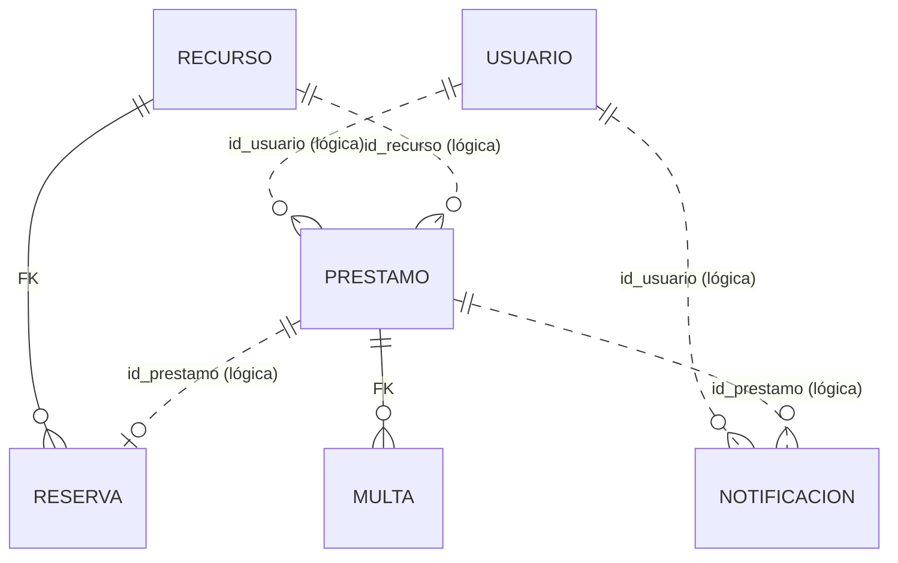
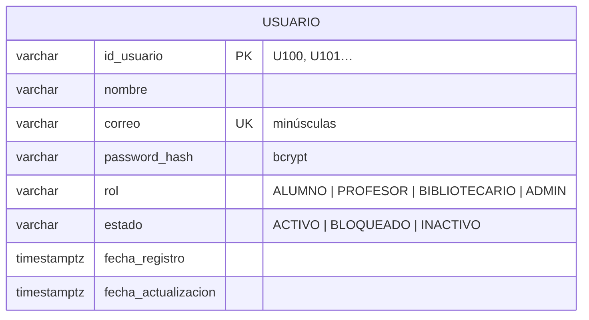
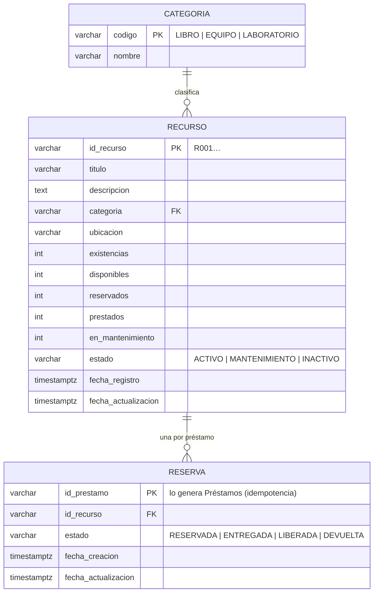
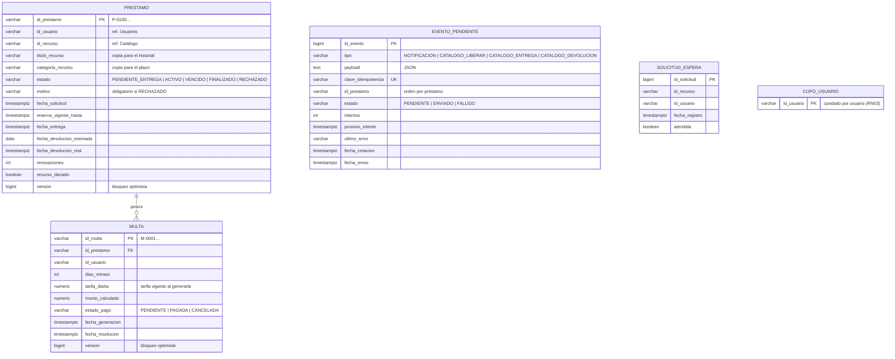
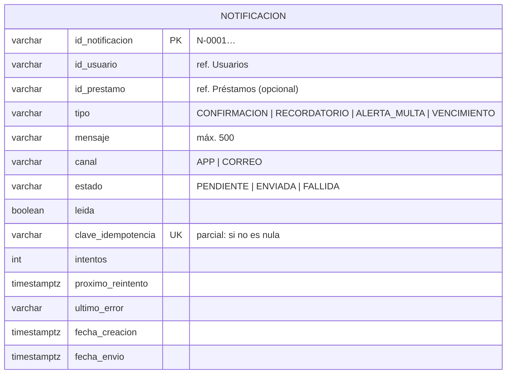

# Diseño de las bases de datos

Cada microservicio es dueño de su propia base PostgreSQL 16, con un usuario que solo tiene acceso a ella (RNF03). Las referencias entre servicios (`id_usuario`, `id_recurso`, `id_prestamo`) se guardan como identificadores **sin llave foránea**, porque viven en bases distintas; la integridad entre servicios la cuidan las APIs (sección 4.3).

| Base | Servicio | Esquema |
|---|---|---|
| `bd_usuarios` | Usuarios (Node.js) | `usuarios/db/schema.sql` |
| `bd_catalogo` | Catálogo (Python) | `catalogo/db/schema.sql` |
| `bd_prestamos` | Préstamos (Java) | `prestamos/src/main/resources/schema.sql` |
| `bd_notificaciones` | Notificaciones (Go) | `notificaciones/db/schema.sql` |

Los diagramas usan la notación de Mermaid (GitHub y la mayoría de los editores de Markdown los dibujan). Las líneas punteadas entre bases son referencias lógicas, no llaves foráneas.

## Vista general

## bd_usuarios

Índices: único sobre `correo`; `lower(nombre)` para búsquedas del panel.

## bd_catalogo

Restricciones: `disponibles + reservados + prestados + en_mantenimiento = existencias` y ningún contador negativo. Índices: trigramas sobre `lower(titulo)` (búsqueda por cualquier parte del título), `(categoria, estado)`, `(id_recurso, estado)` y `(estado, fecha_creacion)` para la conciliación.

## bd_prestamos

- `evento_pendiente` es la bandeja de salida (D6): se escribe en la misma transacción que el préstamo.
- `solicitud_espera` registra la demanda no atendida que impide renovar (RN06).
- `cupo_usuario` solo se usa para `SELECT … FOR UPDATE`: serializa las solicitudes simultáneas de un mismo usuario.

## bd_notificaciones

Índices: único parcial sobre `clave_idempotencia`, `(id_usuario, fecha_creacion DESC)` para la bandeja y `(estado, proximo_reintento)` para el trabajador de reintentos.
